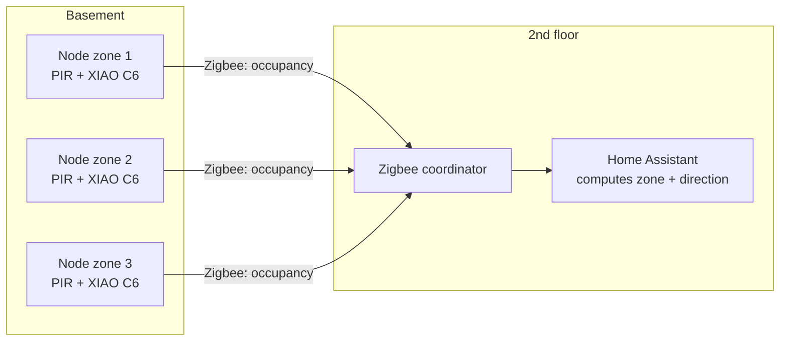
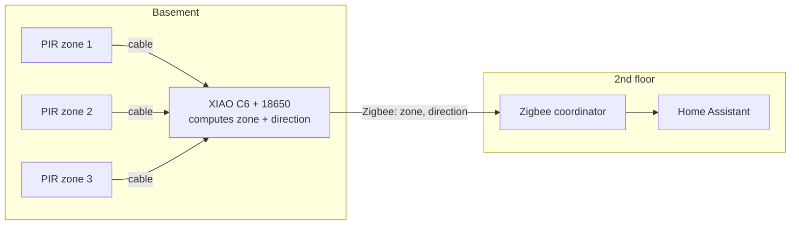
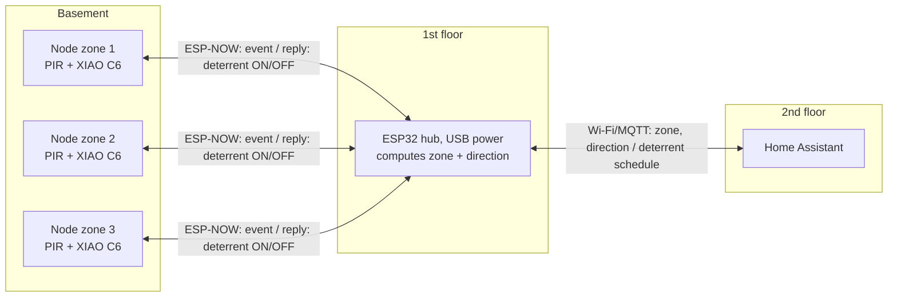

# Rat monitor

Battery-powered nodes that detect rats in a dirt-floor basement and report each visit to Home Assistant over Zigbee. A later phase adds a non-lethal deterrent (randomised ultrasound and light) as a measured experiment.

## How it works

```
[Node x1-3, one per zone]  --Zigbee-->  [Zigbee mesh / coordinator]  -->  [Home Assistant]
  PIR fires -> MCU wakes from deep sleep
    -> report occupancy on, wait for PIR to clear, report off
    -> (phase 2) if deterrent period is ON: random burst
    -> deep sleep
```

- The node sleeps until the PIR fires, so the battery lasts long.
- Each node covers one zone (~2 m of runway). The basement is ~18 m², so 2-3 nodes are enough.
- The floor is uneven, so nodes mount on walls, posts or beams and aim down along runways.
- Home Assistant history counts visits per zone and night.

### Position and direction

Zone = which sensor fired. Direction = the order of two zones within a few seconds. Three places can compute this:

| Option | How | Pros | Cons |
|--------|-----|------|------|
| **HA** (default, phase 1) | Zigbee nodes report occupancy per zone. A template sensor or automation in HA computes zone and direction | No extra hardware; logic easy to change | Logic lives outside the system |
| **A. One controller, wired PIRs** | One battery XIAO ESP32-C6. Each zone's PIR is on a cable (2-4 m) to its own low-power wake pin. After the first trigger, the board stays awake a few seconds to catch a second zone. It reports zone and direction to HA over Zigbee | Cheapest (one board, one battery); no hub; one clock for all zones | Cables in the basement; single point of failure; reflash to change logic |
| **B. Wireless nodes + hub on 1st floor** | Battery nodes in the basement send events over ESP-NOW to a USB-powered ESP32 hub on the 1st floor. The hub computes zone and direction and sends them to HA over Wi-Fi/MQTT. It replies to each node with the deterrent ON/OFF state | No cables; HA can set the deterrent schedule; mains power is available on the 1st floor | Extra hub (~$5); link must pass the floor |

#### HA (default)



#### A. One controller, wired PIRs



The chip can wake on any of several pins and read which pin woke it ([Espressif sleep modes, ext1 wakeup](https://docs.espressif.com/projects/esp-idf/en/stable/esp32c6/api-reference/system/sleep_modes.html)).

#### B. Wireless nodes + hub on 1st floor



- ESP-NOW uses the same 2.4 GHz band as Wi-Fi and Zigbee. A wooden floor has little effect; a concrete slab with rebar can block a lot. Measure RSSI before you mount.
- The hub uses the router's Wi-Fi channel, so the nodes must send on that channel. Set a fixed channel on the router, or let the nodes scan when a send fails ([Espressif ESP-NOW](https://docs.espressif.com/projects/esp-idf/en/stable/esp32/api-reference/network/esp_now.html)).
- For a weak link: use the XIAO external antenna connector and ESP32 long-range (802.11 LR) mode on all devices.
- Put the hub low on the 1st floor, directly above the basement, not behind metal.

How option B works:

- All nodes run the same code. A node can have a PIR, an SHT40 climate sensor (optional), or both. Set `HAS_PIR = false` for a climate-only node. The SHT40 is found on I2C at boot.
- A node wakes on the PIR or every 15 min (timer), sends one message, waits for the hub's reply, and sleeps again.
- The node finds the hub's channel itself: if the hub does not reply, it tries channels 1-13 and remembers the one that works.
- The hub replies with the deterrent ON/OFF state (an HA switch), and sends each message to HA over MQTT. HA finds new nodes by itself (MQTT discovery). The node ID is the end of its MAC address.

### Climate (optional, option B)

Temperature and humidity in the basement, from the same nodes. Add an SHT40 to any node; nothing else changes.

- Dirt-floor basements often stay above 80 % RH. Above ~75-80 % for long periods there is a risk of mould.
- Compare the dew point inside and outside: ventilation only dries the basement when the outdoor air has a lower dew point. HA can compute the dew point, and take outdoor values from a weather integration (for example Met.no), so no outdoor sensor is needed.
- An optional SHT40 on the hub measures the 1st floor.
- Power: an ESP-NOW send takes a fraction of a second, so a reading every 15 min adds little to the battery use.

Not feasible: battery nodes that talk to each other without a hub, because a sleeping node cannot listen.

### Phases

1. **Monitor node**: XIAO ESP32-C6 + PIR + 18650. Build one, then copy to 2-3 zones.
   - Optional (option B): SHT40 for temperature and humidity on one or more nodes.
2. **Deterrent experiment**: add ultrasonic piezo + LED strobe. Alternate ON and OFF weeks and compare visits per night.
3. **Confirmation**: IR camera node and/or IR break-beam.
4. **Optional**: ultrasonic audio node that listens for rat calls.

## Research

### Deterrence

- The FTC sent more than 60 warning letters about ultrasonic pest device claims, and rodents get used to the sound ([FTC, 2001](https://www.ftc.gov/news-events/news/press-releases/2001/05/ftc-warns-manufacturers-retailers-ultrasonic-pest-control-devices)).
- UC IPM calls ultrasound "not effective" for rats ([UC IPM Q&A, 2024](https://class.ucanr.edu/sites/default/files/2024-12/404636.pdf)). Rats stayed in attics with devices on ([U. Arizona Extension](https://extension.arizona.edu/sites/extension.arizona.edu/files/barnesm/UltrasonicPestControl.pdf)).
- A review of 23 studies found no lasting effect. The best results came from mixed frequencies, varied timing and a moved source (Bomford & O'Brien 1990, summarised by [NZ DOC](https://dxcprod.doc.govt.nz/globalassets/documents/science-and-technical/casn151.pdf)).
- Ultrasound is line-of-sight. Boxes, uneven soil and insulation absorb it ([Whitford 2018](https://escholarship.org/uc/item/3239b3cj)).
- Bright light is aversive to rats in lab tests, but field data is missing. Playback of 22 kHz distress calls gives mixed results ([PubMed](https://pubmed.ncbi.nlm.nih.gov/24923696)).

**Design decision:** the deterrent is an experiment, not a promise. It plays only on detection, with random frequency, length and delay, from one node per zone. ON and OFF weeks show if it has an effect.

### Detection

- Rats call at ~22 kHz (alarm, 18-32 kHz) and ~50 kHz (35-80 kHz). This needs 96-192 kS/s sampling, and nobody knows how often wild rats call ([eLife](https://elifesciences.org/reviewed-preprints/88810), [bioRxiv 2024](https://www.biorxiv.org/content/10.1101/2024.12.09.627446.full.pdf)).
- Only the SPU0410LR5H-**QB** MEMS mic reaches 80 kHz. An ESP32-S3 can record 192 kHz ([Esperdyne](https://methodsblog.com/2026/02/12/from-first-clicks-to-building-esperdyne-a-personal-journey-into-bat-bioacoustics/)).
- PIR sensors detect small animals at short range, ~2-3 m ([UCL camera-trap study](https://discovery-pp.ucl.ac.uk/1508048/7/Rowcliffe_Hofmeester_et_al-2016-Remote_Sensing_in_Ecology_and_Conservation.pdf), [SPYCE, U. Twente](https://essay.utwente.nl/essays/97103)). The commercial Anticimex SMART unit is PIR-based with ~1 year battery life.
- An IR break-beam across a runway is the most reliable cheap trigger. Two beams give direction ([Rentokil Mouse Monitor Unit](https://www.thecaterer.com/products/mouse-monitor-unit-from-rentokil)).
- Locating sounds with several mics (TDOA) works in the audible band, but is hard at ultrasonic rates on a hobby budget ([BEEI](https://beei.org/index.php/EEI/article/view/10523)).
- ESP32-CAM + PIR + an image classifier can tell rats from other animals ([UniKore](https://iris.unikore.it/handle/11387/181026)). No public rat dataset exists, so own IR images are necessary.

### Climate sensor

- DHT11 (in the [inventory](/inventory.md)) measures only 20-80 % RH at ±5 %, so it misses the high values in a basement. DHT22 drifts in high humidity.
- Sensirion SHT40: ±1.8 % RH, ±0.2 °C, ~0.1 µA idle, and a built-in heater to recover after condensation ([Sensirion SHT4x datasheet](https://sensirion.com/products/catalog/SHT40)).

**Design decision:** a low-power PIR is the trigger. One node per zone gives coarse location. Audio and camera are later, secondary sensors.

### Power and radio

- XIAO ESP32-C6 deep sleep measures ~17 µA ([Qoitech](https://www.qoitech.com/?p=19961)).
- Short radio wakes (ESP-NOW, Zigbee) give far longer battery life than a Wi-Fi join per event ([ThingPulse](https://thingpulse.com/esp32-ultra-long-battery-life-with-espnow/)).
- Estimate: 30 µA sleep + 20 events/day (3 s awake, 5 s burst at 150 mA) ≈ 6 mAh/day, so ~1 year on one 18650. Deterrent bursts use most of the energy.

**Design decision:** Zigbee sleepy end device. The node only reports, because sleeping nodes do not get commands from Home Assistant.

## Hardware

### Phase 1 (one node, ~$15)

- Board: Seeed Studio XIAO ESP32-C6 (~$6)
- Components:
  - AM312 mini PIR, 3.3 V, ~15 µA (~$1.5)
  - 18650 Li-ion cell + holder (~$6). Use LiFePO4 if the basement is cold.
  - Small box and mounting bracket

### Option B (hub + nodes)

- Hub: any USB-powered ESP32, e.g. ESP32-C3 SuperMini (~$3) or XIAO ESP32-C6 (~$6), plus a USB charger.
- Node: same as phase 1. A climate-only node has no PIR.
- Home Assistant: Mosquitto broker add-on and the MQTT integration.

### Climate (optional)

- SHT40 module, I2C (~$3) per node, and one for the hub if you want 1st floor values.
- Put the board in a closed box, but give the sensor air: a box with holes facing down, or the sensor on a short cable outside the box. Keep it off the soil and away from vents.

### Options

| Part | Option | Note |
|------|--------|------|
| Board | **XIAO ESP32-C6, Zigbee** | ~17 µA sleep, on-board LiPo charger |
| Board | XIAO ESP32-C6, Wi-Fi + MQTT/ESPHome | Fallback if Zigbee link is poor. ~2-3 s at ~100 mA per event |
| Trigger | **AM312 PIR** | ~15 µA, drives the wake pin directly |
| Trigger | Panasonic EKMB PIR (1 µA type) | ~$12, better range |
| Trigger | IR break-beam | IR LED + IR receiver from [inventory](/inventory.md) on a plank; two beams give direction |
| Trigger | AMG8833 thermal 8x8 | ~$40, < 1 m, confirmation only |
| Climate | **SHT40** | ~$3, I2C, optional |
| Climate | BME280 / AHT20 | ~$2-3, less accurate at high humidity |
| Climate | DHT11 / DHT22 | Not suitable: range or drift in high humidity |
| Deterrent | **Kemo L010 piezo (2-60 kHz)** + MT3608 boost (12 V) + TC4427 driver | ~$12, random sweeps 20-50 kHz |
| Deterrent | 40 kHz transducer (MA40S4S or generic) | $1-5, one frequency, habituation risk |
| Deterrent | White LED strobe via MOSFET | ~$1 |
| Camera | ESP32-CAM + PIR + IR LEDs | ~$10, ~1 mA sleep, needs bigger battery |
| Audio | ESP32-S3 + SPU0410LR5H-QB | 192 kS/s, high power, research grade |

Not suitable: Arduino Uno (no deep sleep), Raspberry Pi Zero 2 W (~100 mA idle), RP2040 (~1 mA dormant).

## Wiring

### Node (HA default and option B)

| Component pin | XIAO pin |
|---------------|----------|
| PIR VCC       | 3V3      |
| PIR GND       | GND      |
| PIR OUT       | D1       |
| 18650 +       | BAT+ (pad under the board) |
| 18650 -       | BAT- (pad under the board) |

D1 (GPIO1) is a low-power GPIO, so it can wake the chip from deep sleep. USB-C charges the cell.

[Wokwi diagram](diagram.json)

### Option B node

Same as the node above, plus the optional SHT40:

| Component pin | XIAO pin |
|---------------|----------|
| SHT40 VCC (optional) | 3V3 |
| SHT40 GND (optional) | GND |
| SHT40 SDA (optional) | D4 (SDA) |
| SHT40 SCL (optional) | D5 (SCL) |

A climate-only node has no PIR. Set `HAS_PIR = false` in the code.

### Option B hub

Any USB-powered ESP32. No parts are needed. The SHT40 is optional and uses the same wiring as on the node (SDA/SCL pins of the board).

### Option A controller

| Component pin | XIAO pin |
|---------------|----------|
| PIR 1-3 VCC   | 3V3      |
| PIR 1-3 GND   | GND      |
| PIR 1 OUT (zone 1) | D0  |
| PIR 2 OUT (zone 2) | D1  |
| PIR 3 OUT (zone 3) | D2  |
| 18650 +       | BAT+ (pad under the board) |
| 18650 -       | BAT- (pad under the board) |

D0-D2 (GPIO0-2) are low-power GPIOs, so each one can wake the chip. Use 3-core cable (2-4 m) from each PIR to the board.

[Wokwi diagram, option A](diagram-option-a.json)

## Libraries

- Zigbee (included in the [Arduino ESP32 core](https://github.com/espressif/arduino-esp32) 3.x)
- Option B:
  - ESP-NOW and Wi-Fi (included in the Arduino ESP32 core 3.x)
  - [PubSubClient](https://github.com/knolleary/pubsubclient) by Nick O'Leary (hub only, install from the Library Manager)
  - `RatMonitor` in [libraries/RatMonitor](https://github.com/JorgenJJ/arduino-projects/tree/main/libraries/RatMonitor): the message format and the SHT40 reader, shared by node and hub. The IDE finds it when the sketchbook location is this repo.

Arduino IDE settings:
- Board: XIAO_ESP32C6
- Tools → Zigbee mode: Zigbee ED (end device)
- Tools → Partition Scheme: Zigbee 4MB with spiffs

## Code

### Zigbee node (HA default)

[rat-monitor.ino](rat-monitor.ino ':include :type=code')

### Option B node

Board: XIAO_ESP32C6. Set `HAS_PIR` at the top.

[node.ino](node/node.ino ':include :type=code')

### Option B hub

Copy `hub/secrets.example.h` to `hub/secrets.h` and fill in Wi-Fi and MQTT. `secrets.h` is not committed.

[hub.ino](hub/hub.ino ':include :type=code')

### Shared (option B)

[RatMonitor.h](../../libraries/RatMonitor/RatMonitor.h ':include :type=code')

## Home Assistant

- Pair: put ZHA or Zigbee2MQTT in pairing mode, then power the node. It shows as an occupancy sensor.
- Check link quality (LQI) with the node in place before you mount it. Move the coordinator or add a Zigbee router if it is poor.
- Option B: install the Mosquitto broker add-on and the MQTT integration. Start the hub, then power each node. The hub prints its Wi-Fi channel on the serial monitor. Nodes show up as devices named "Rat monitor <id>", with Motion and/or Temperature and Humidity. The hub adds a Deterrent switch.
- Option B: temperature and humidity show as unavailable if a node misses about 3 readings (flat battery or no link).
- Climate: add a [Dew point](https://www.home-assistant.io/integrations/template/) template sensor, and an automation that warns when humidity stays above 80 %.
- Count visits per night with a [History stats](https://www.home-assistant.io/integrations/history_stats/) helper (type: count, state: on).
